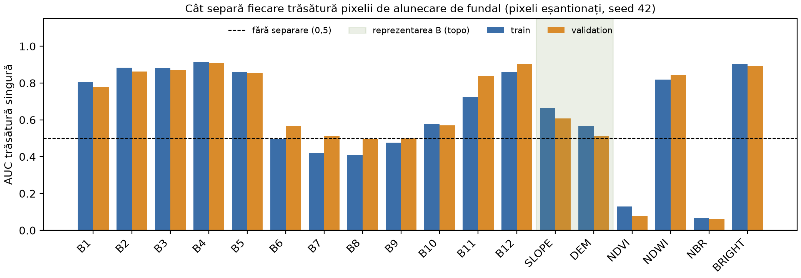
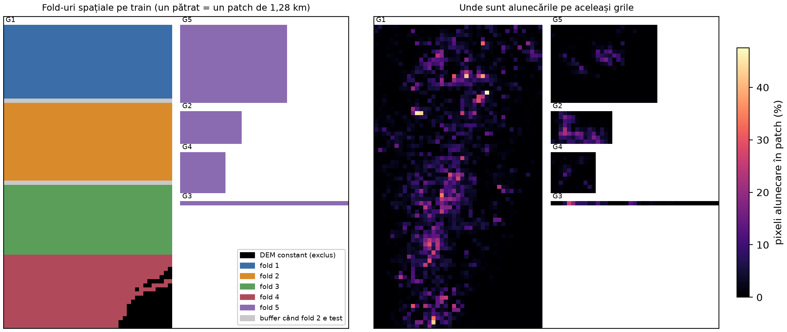
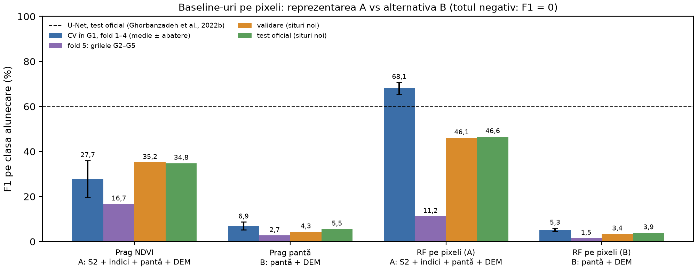

# Methods (H2): reprezentare, baseline-uri și protocol experimental

Secțiunea descrie cum intră observațiile din Landslide4Sense în model, pe ce împărțire se evaluează și ce baseline-uri trebuie bătute la CP3. Toate cifrele sunt generate de scripturile din repo, cu seed 42. Comenzile de reproducere sunt la final.

## 1. Reprezentarea

Fiecare pixel de ~10 m devine un vector de trăsături. Comparăm două reprezentări (`src/l4s/features.py`):

| Reprezentare | Trăsături | Rol |
|---|---|---|
| **A: S2 + indici + topografie** | 18: B1–B12, pantă, DEM, NDVI, NDWI, NBR, BRIGHT | Detecția alunecărilor produse |
| **B: doar topografie** | 2: pantă, DEM | Proxy de susceptibilitate: cât din distribuția alunecărilor se anticipează fără imagine optică |

Indicii derivați sunt:

- NDVI = (B8 − B4) / (B8 + B4): vegetația scade pe cicatricea alunecării;
- NDWI = (B3 − B8) / (B3 + B8): apă și umiditate (McFeeters);
- NBR = (B8 − B12) / (B8 + B12): sol gol și vegetație distrusă;
- BRIGHT = media B2, B3, B4: solul proaspăt expus e mai luminos.

**Preprocesare.** Pixelii zero în toate benzile (7.423 în train, 256 în validare, 512 în test) se exclud din antrenare și din evaluare. Benzile din fișiere sunt scalate cu constante nedocumentate (vezi data card-ul), deci indicii de mai sus nu au valorile fizice standard. Sunt rapoarte normalizate între benzi scalate. Baseline-urile de la CP2 (praguri și arbori) nu depind de scala trăsăturilor, așa că nu normalizăm. Pentru rețelele de la CP3, statisticile de normalizare se vor calcula doar pe partea de antrenare a fiecărui fold.

**Cât separă fiecare trăsătură** (`scripts/describe_representations.py`). Pe pixeli eșantionați (până la 100 de alunecare și 300 de fundal per patch), am calculat AUC-ul fiecărei trăsături luate singure. AUC = 0,5 înseamnă nicio separare, iar valorile sub 0,5 arată că trăsătura scade pe alunecări.

| Trăsătură | Reprezentare | AUC train | AUC validare |
|---|---|---:|---:|
| B4 (roșu) | A | 0,913 | 0,909 |
| BRIGHT | A | 0,902 | 0,894 |
| B12 (SWIR2) | A | 0,861 | 0,903 |
| NDWI | A | 0,818 | 0,845 |
| NDVI | A | 0,129 | 0,080 |
| NBR | A | 0,068 | 0,060 |
| Pantă | A și B | 0,664 | 0,608 |
| DEM | A și B | 0,565 | 0,511 |

Trăsăturile spectrale separă puternic clasele, iar ordinea lor se păstrează pe validare, care vine din alte situri. Topografia singură separă slab, iar DEM-ul e aproape de nivelul întâmplător pe validare.



*Figura 1. AUC-ul fiecărei trăsături luate singure, pe train și pe validare. Zona verde marchează reprezentarea B.*

## 2. Protocolul experimental

### 2.1 Structura spațială a setului de train

La CP1 am observat că ID-urile consecutive sunt patch-uri vecine. La CP2 am reconstruit așezarea completă din continuitatea marginilor DEM (`scripts/make_splits.py`). Cele 3.799 de patch-uri de train formează **5 grile**, ordonate rând cu rând. Vecinul din dreapta lui *i* este *i*+1, iar cel de dedesubt este *i* + lățimea grilei.

| Grilă | ID-uri | Coloane × rânduri | Continuitate orizontală | Continuitate verticală |
|---|---|---|---:|---:|
| G1 | 1–3034 | 41 × 74 | 100% | 100% |
| G2 | 3035–3154 | 15 × 8 | 100% | 100% |
| G3 | 3155–3195 | 41 × 1 | 100% | – |
| G4 | 3196–3305 | 11 × 10 | 100% | 100% |
| G5 | 3306–3799 | 26 × 19 | 100% | 100% |

Continuitatea înseamnă diferența medie dintre margini sub percentila 5 a perechilor aleatoare. G1 conține 80% din train și toate cele 115 patch-uri cu DEM constant. Grilele mici nu par lipite de G1: doar 27 din 765 de patch-uri (3,5%) au o margine aproape identică cu una din G1, aproape toate pe teren plat, deci potriviri întâmplătoare. Setul nu publică metadatele de sit, deci nu știm ce grilă corespunde fiecăruia dintre cele 4 situri de train.

### 2.2 Fold-uri spațiale cu buffer

- **Fold-urile 1–4** sunt benzi orizontale din G1 (rândurile 1–19, 20–38, 39–56 și 57–74), adică blocuri contigue de ID-uri. Ele măsoară generalizarea în același sit, pe zone nevăzute.
- **Fold-ul 5** conține grilele G2–G5. El măsoară transferul către altă zonă, cu antrenare aproape numai pe G1.
- **Buffer.** Când un fold e test, patch-urile din aceeași grilă aflate la cel mult un patch de el (~1,3 km, inclusiv pe diagonală) nu intră la antrenare.
- **Excludere.** Cele 115 patch-uri cu DEM constant ies din toate fold-urile. Nu au relief, deci reprezentarea B nu are intrare pentru ele, nu conțin alunecări și nu au echivalent în validare sau test.

| Fold | Regiune de test | Test | Antrenare | Buffer | Test cu alunecări | Pixeli alunecare în test |
|---:|---|---:|---:|---:|---:|---:|
| 1 | G1, rândurile 1–19 | 779 | 2.864 | 41 | 560 | 2,83% |
| 2 | G1, rândurile 20–38 | 779 | 2.823 | 82 | 583 | 2,40% |
| 3 | G1, rândurile 39–56 | 738 | 2.864 | 82 | 470 | 3,04% |
| 4 | G1, rândurile 57–74 | 623 | 3.020 | 41 | 321 | 2,30% |
| 5 | G2–G5 | 765 | 2.919 | 0 | 297 | 1,38% |

**Verificarea leakage-ului.** Am numărat, pe fiecare fold, ce parte din patch-urile de test are cel puțin un vecin confirmat (margine DEM continuă) în setul de antrenare:

| Împărțire | Fold 1 | Fold 2 | Fold 3 | Fold 4 | Fold 5 |
|---|---:|---:|---:|---:|---:|
| Aleatoare, aceleași mărimi | 99,5% | 99,6% | 100% | 100% | 100% |
| Blocuri, fără buffer | 5,3% | 10,5% | 11,1% | 6,6% | 0% |
| **Blocuri cu buffer (protocolul ales)** | **0%** | **0%** | **0%** | **0%** | **0%** |

Un split aleator ar pune practic fiecare patch de test lângă un patch de antrenare. Așa se explică, cel mai probabil, rezultatele umflate raportate cu validare încrucișată pe train în literatură.



*Figura 2. Stânga: fold-urile pe cele 5 grile (un pătrat = un patch de 1,28 km), cu buffer-ul ilustrat pentru fold-ul 2 și patch-urile excluse. Dreapta: proporția de pixeli de alunecare în fiecare patch.*

### 2.3 Validarea și testul oficial

Validarea (245 de patch-uri) și testul oficial (800) vin din alte situri decât train-ul, deci sunt teste geografice reale. Modelele pentru ele se antrenează pe tot train-ul (fără patch-urile excluse).

- **Validarea** verifică alegerile de model. La CP2, hiperparametrii sunt fixați dinainte, deci validarea doar se raportează.
- **Testul** se evaluează o singură dată, cu configurația fixată, și nu se folosește la nicio alegere. Măștile de validare și test provin de pe Hugging Face. Corespondența lor cu imaginile e verificată statistic în data card.

### 2.4 Metrici

Metrica principală este **F1 pe clasa alunecare**, din matricea de confuzie cumulată pe toți pixelii valizi ai unui split, ca în competiția Landslide4Sense. Raportăm și precizia, recall-ul și IoU-ul. AUC și AP (aria sub curba precizie-recall) evaluează scorurile fără prag. Acuratețea nu e informativă: „totul fără alunecare” obține 97,7–98,3% și F1 = 0. Pentru CV raportăm media și abaterea standard între fold-uri, separat pentru fold-urile 1–4 (același sit) și fold-ul 5 (transfer).

## 3. Baseline-uri

Baseline-urile merg de la trivial la clasicul puternic (`scripts/run_baselines.py`):

1. **Totul negativ:** „fără alunecare” peste tot.
2. **Prag NDVI** (A): alunecare dacă NDVI < prag.
3. **Prag pantă** (B): alunecare dacă panta > prag.
4. **Random Forest pe pixeli, A:** 18 trăsături.
5. **Random Forest pe pixeli, B:** pantă și DEM.

**Antrenare.** Din fiecare patch de antrenare se eșantionează până la 50 de pixeli de alunecare și 150 de fundal (656.032 de pixeli pe tot train-ul). RF folosește hiperparametri fixați dinainte, nereglați: 100 de arbori, adâncime maximă 20, minimum 5 pixeli în frunză, `max_features = sqrt`. **Pragul** fiecărui baseline se alege pe datele de antrenare, maximizând F1: la RF pe predicțiile out-of-bag, la regulile simple direct pe eșantion. Pixelii eșantionați sunt ponderați ca să readucă eșantionul la prevalența reală. **Evaluarea** se face pe toți pixelii valizi ai patch-urilor de test, nu pe eșantion.

### 3.1 Rezultate

| Baseline | Reprezentare | CV G1 (fold 1–4) | Fold 5 (G2–G5) | Validare | Test | IoU test | AUC test | AP test |
|---|---|---:|---:|---:|---:|---:|---:|---:|
| Totul negativ | – | 0,00 ± 0,00 | 0,00 | 0,00 | 0,00 | 0,00 | 0,500 | 0,020 |
| Prag NDVI | A | 27,74 ± 8,21 | 16,68 | 35,15 | 34,81 | 21,07 | 0,941 | 0,249 |
| Prag pantă | B | 6,92 ± 1,77 | 2,69 | 4,34 | 5,55 | 2,85 | 0,581 | 0,030 |
| **RF pe pixeli** | **A** | **68,09 ± 2,61** | 11,19 | **46,09** | **46,59** | **30,37** | **0,963** | **0,442** |
| RF pe pixeli | B | 5,30 ± 0,68 | 1,50 | 3,39 | 3,90 | 1,99 | 0,565 | 0,023 |
| *U-Net (literatură)* | *S2 + DEM/pantă, cu context spațial* | – | – | – | *59,92* | – | – | – |

F1 este în procente. Referința U-Net vine din Ghorbanzadeh et al. (2022b), pe același test oficial. Pe test, RF (A) are precizia 43,5% și recall-ul 50,1%, iar pragul NDVI are precizia 22,7% și recall-ul 75,1%.



*Figura 3. F1 pe clasa alunecare pentru baseline-uri, pe cele patru evaluări. Linia punctată marchează U-Net-ul din literatură.*

### 3.2 Ce rezultă pentru CP3

- **Reprezentarea A depășește clar alternativa B** la orice evaluare. Pe test, F1 este 46,6% față de 3,9% la RF, iar AUC este 0,963 față de 0,565. La nivel de pixel, topografia singură nu anticipează aproape deloc unde sunt alunecările. Ca proxy de susceptibilitate, B trebuie evaluată la scara deciziei clientului (versant sau patch), nu pe pixel.
- **Generalizarea depinde puternic de zonă.** RF (A) are F1 68,1% pe benzi nevăzute din G1, 46,6% pe testul oficial și doar 11,2% pe grilele G2–G5. Cauza nu e încă clară. Candidații sunt condiții spectrale diferite și prevalența mai mică din fold-ul 5 (1,38%). De aceea, la CP3, fold-ul 5 se raportează separat, nu doar în media CV.
- **Ținta de bătut.** Cel mai bun baseline este RF (A), cu F1 46,6% pe test, sub U-Net-ul din literatură (59,9%). Diferența e de așteptat, fiindcă RF clasifică fiecare pixel separat, fără contextul spațial al patch-ului. Metoda de la CP3 trebuie să bată RF (A) pe aceleași fold-uri, pe mai multe seed-uri, cu intervale.

## 4. Limite ale protocolului

- Grilele nu sunt situri cu nume. Fold-urile 1–4 provin din aceeași zonă (G1), deci măsoară generalizarea în interiorul sitului, iar transferul se vede în fold-ul 5, în validare și în test.
- Buffer-ul de un patch elimină vecinii direcți, nu și corelația spațială la distanțe mai mari de ~1,3 km.
- Indicii sunt calculați din benzi scalate și nu se compară direct cu praguri din literatură.
- Pixelii neetichetați nu sunt garantat stabili (setul acoperă doar zone afectate), deci precizia poate fi subestimată.

## Reproducere

Din rădăcina repo-ului, cu datele așezate conform README-ului:

```bash
python scripts/describe_representations.py   # reprezentarea, ~1,5 min
python scripts/make_splits.py                # protocolul, ~1 min
python scripts/run_baselines.py              # baseline-urile, ~20 min
```

Rezultatele ajung în `reports/`: `representation_stats.csv`, `splits.json`, `baseline_results.{csv,json,md}` și figurile din `reports/figures/`.
