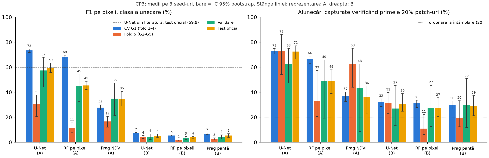

# Results (H2): modelul v1 față de baseline-uri

Secțiunea compară modelul v1 (U-Net) cu baseline-urile din CP2, pe protocolul din `docs/methods_H2.md`. Fiecare model e rulat pe 3 seed-uri (42, 43, 44), iar fiecare rezultat are un interval de încredere de 95%. Toate cifrele sunt generate de `scripts/aggregate_results.py`; tabelele complete sunt în `reports/CP3/results_v1.md`, iar datele în `reports/CP3/results_v1_H2.csv`.

## 1. Ce s-a rulat

| Model | Reprezentare | Ce învață | Configurație |
|---|---|---|---|
| **U-Net (v1)** | A (18 canale) și B (pantă + DEM) | segmentare pe patch, folosește contextul spațial | lățime 32, 4 niveluri, 7,8 M parametri; BCE + Dice pe pixelii valizi; AdamW, lr 1e-3, cosinus; 15 epoci, batch 16; rotații de 90° și flip; fp32 |
| RF pe pixeli | A și B | fiecare pixel separat | configurația din CP2, neschimbată |
| Prag NDVI / prag pantă | A / B | o singură trăsătură | ca la CP2 |

**Ce alege fiecare model și pe ce date.** La U-Net, epoca și pragul de decizie se aleg pe o validare internă: 7 rânduri din G1, separate de restul antrenării printr-un rând de buffer și luate de la capătul cel mai îndepărtat de fold-ul de test. Normalizarea se calculează doar pe patch-urile de antrenare. La RF, pragul se alege pe predicțiile out-of-bag, ca la CP2.

**Ce controlează seed-ul.** La U-Net: inițializarea, ordinea batch-urilor și augmentarea. La RF: eșantionarea pixelilor de antrenare și arborii. Fold-urile sunt aceleași pentru toate seed-urile.

**Testul oficial.** Fiecare model și seed a fost evaluat pe test o singură dată, cu configurația fixată dinainte. Rezultatul pe test nu a influențat nicio alegere. O rulare de verificare de 2 epoci a atins testul o dată, în timpul dezvoltării; configurația nu s-a schimbat după ea.

În total sunt 108 rulări: 6 modele × 3 seed-uri × (5 fold-uri + antrenare pe tot train-ul). Antrenarea U-Net-urilor a durat ~8 ore pe un GTX 1650.

## 2. Cum se calculează intervalele

- **Estimarea:** F1 pe clasa alunecare, din confuzia cumulată pe pixelii valizi, mediat pe seed-uri. La CV G1, media e pe fold-urile 1–4 × 3 seed-uri.
- **Intervalul de 95%:** bootstrap pe clustere, cu 1000 de reeșantionări. În train, clusterul e un rând al grilei, pentru că patch-urile vecine sunt corelate. În validare și test așezarea patch-urilor nu se cunoaște, deci clusterul e patch-ul.
- **Comparațiile sunt pereche:** toate modelele și seed-urile folosesc aceleași reeșantionări. Pentru ΔF1 se raportează intervalul și p = fracția reeșantionărilor în care Δ ≤ 0.
- **Variația între seed-uri** se raportează separat, ca interval min–max.

## 3. Tabelul principal

**F1 (%) [IC 95%], media pe 3 seed-uri**

| Model | CV G1 (fold 1–4) | Fold 5 (G2–G5) | Validare | Test oficial | AP test |
|---|---:|---:|---:|---:|---:|
| **U-Net (A)** | **73,3** [71,8; 74,6] | **30,2** [20,6; 37,7] | **57,3** [44,1; 67,9] | **59,4** [55,8; 63,3] | **0,666** |
| RF pe pixeli (A) | 68,2 [66,6; 69,6] | 11,3 [8,1; 15,5] | 44,8 [32,7; 54,4] | 45,3 [42,1; 48,9] | 0,433 |
| Prag NDVI (A) | 27,7 [25,7; 29,9] | 16,7 [12,1; 20,8] | 34,9 [21,6; 47,2] | 34,6 [29,0; 40,7] | 0,249 |
| U-Net (B) | 7,2 [6,5; 7,9] | 4,3 [2,9; 5,4] | 4,5 [2,5; 6,8] | 5,2 [4,0; 6,5] | 0,028 |
| RF pe pixeli (B) | 5,5 [5,1; 5,8] | 1,5 [1,1; 2,0] | 3,4 [2,3; 4,6] | 4,0 [3,3; 4,7] | 0,023 |
| Prag pantă (B) | 6,9 [6,4; 7,5] | 2,8 [2,0; 3,5] | 4,2 [2,8; 6,0] | 5,4 [4,1; 6,9] | 0,030 |

Reper: U-Net-ul din literatură are F1 = 59,9% pe testul oficial (Ghorbanzadeh et al., 2022b). Un model care marchează totul ca fundal are F1 = 0. Pe test, alunecările acoperă ~2% din pixeli.

**Variația între seed-uri, F1 (%) min–max**

| Model | CV G1 | Fold 5 | Validare | Test |
|---|---:|---:|---:|---:|
| U-Net (A) | 72,6–73,8 | 28,7–32,3 | 56,5–58,9 | 58,5–61,3 |
| RF pe pixeli (A) | 68,1–68,3 | 11,1–11,7 | 43,7–46,1 | 43,6–47,0 |
| U-Net (B) | 7,0–7,4 | 2,8–6,0 | 4,2–4,8 | 5,0–5,3 |

**ΔF1 pereche (puncte) [IC 95%]**

| Comparație | CV G1 | Fold 5 | Validare | Test |
|---|---:|---:|---:|---:|
| U-Net (A) − RF (A) | **+5,1** [+4,7; +5,6] | **+18,9** [+8,9; +27,2] | **+12,5** [+9,4; +15,9] | **+14,1** [+12,0; +16,2] |
| U-Net (A) − prag NDVI | +45,6 [+43,8; +47,2] | +13,6 [+7,3; +18,8] | +22,5 [+5,5; +35,0] | +24,9 [+19,5; +29,7] |
| U-Net (B) − RF (B) | +1,8 [+1,3; +2,2] | +2,8 [+1,7; +3,7] | +1,0 [−0,1; +2,4] | +1,2 [+0,4; +2,1] |
| U-Net (B) − prag pantă | +0,3 [−0,1; +0,6] | +1,5 [+0,7; +2,2] | +0,2 [−1,0; +1,5] | −0,2 [−1,2; +0,8] |
| U-Net (A) − U-Net (B) | +66,1 [+64,7; +67,2] | +25,9 [+16,8; +33,4] | +52,9 [+41,0; +61,9] | +54,2 [+51,3; +57,5] |

**Precizie / recall (%), media pe seed-uri, pentru reprezentarea A**

| Model | CV G1 | Fold 5 | Validare | Test |
|---|---:|---:|---:|---:|
| U-Net (A) | 73,3 / 74,1 | 21,9 / 49,0 | 47,9 / 71,6 | 48,5 / 76,9 |
| RF pe pixeli (A) | 64,8 / 72,2 | 8,7 / 16,2 | 41,7 / 48,6 | 42,1 / 49,2 |



## 4. Metrica pentru decizie: ce verifică echipele din teren

Consiliul Județean nu verifică pixeli, ci zone. Am ordonat patch-urile (~1,28 × 1,28 km) după scorul mediu prezis și am măsurat ce fracție din pixelii de alunecare se află în primele 20% patch-uri. O ordonare la întâmplare dă în medie 20%.

**Alunecări capturate verificând primele 20% patch-uri (%) [IC 95%]**

| Model | CV G1 | Fold 5 | Validare | Test |
|---|---:|---:|---:|---:|
| **U-Net (A)** | **73,2** [70,5; 75,0] | **73,1** [54,2; 86,1] | **62,7** [47,3; 75,0] | **72,5** [66,6; 77,1] |
| RF pe pixeli (A) | 66,4 [63,1; 68,9] | 32,8 [20,6; 57,5] | 49,1 [19,4; 65,8] | 49,1 [38,9; 58,0] |
| Prag NDVI (A) | 36,8 [32,7; 40,3] | 62,5 [43,9; 75,1] | 43,0 [8,5; 62,6] | 35,9 [22,8; 45,0] |
| U-Net (B) | 31,8 [28,7; 34,8] | 31,2 [23,2; 39,9] | 26,9 [13,7; 45,5] | 30,3 [24,9; 39,0] |
| RF pe pixeli (B) | 31,2 [27,8; 33,7] | 10,9 [6,2; 22,1] | 27,1 [12,8; 45,6] | 27,4 [20,8; 35,6] |
| Prag pantă (B) | 29,9 [26,7; 32,9] | 19,6 [12,4; 33,2] | 29,8 [11,8; 51,1] | 28,9 [21,3; 37,3] |

Pe test, Δ între U-Net (A) și RF (A) e de +23,3 puncte [+17,9; +29,9]. Pe fold 5 e de +40,3 [+24,6; +49,9].

## 5. Ce rezultă

1. **Modelul v1 bate cel mai puternic baseline pe toate cele patru evaluări.** Intervalul diferenței exclude zero peste tot. Câștigul e mic în același sit (+5 puncte pe CV G1) și mare pe situri noi (+12–14 pe validare și test, +19 pe fold 5). Contextul spațial ajută deci mai ales la generalizare, cum anticipam la CP2. Pe test, U-Net-ul ajunge la nivelul literaturii (59,4 [55,8; 63,3] față de 59,9).
2. **RF are AUC pe pixeli mai mare decât U-Net-ul pe CV (0,988 față de 0,977), dar AP mai mic (0,75 față de 0,81).** Diferența vine din zona cu scoruri mari, unde se decide ce pixeli se marchează. Din acest motiv raportăm F1 și AP, nu AUC.
3. **Transferul către altă zonă (fold 5) rămâne punctul slab, cu F1 de doar 30%.** Ordonarea e totuși bună: verificând primele 20% patch-uri se prind 73% din alunecări, iar AUC pe pixeli e 0,93. Problema e mai ales pragul. E ales pe G1 și, pe G2–G5, unde alunecările sunt mai rare, produce multe alarme false: precizia e 22% la un recall de 49%. Pe validare și test apare același dezechilibru, mai slab: recall 72–77%, precizie ~48%. Calibrarea pragului pe o zonă nouă e tema pentru CP4 și CP6.
4. **Reprezentarea B dă un rezultat negativ la nivel de pixel.** Indiferent de model, F1 e 4–7%. U-Net (B) nu se distinge de pragul simplu pe pantă (−0,2 puncte pe test [−1,2; +0,8]). Ca ordonare de zone, B depășește puțin întâmplarea (~30% față de 20%), dar intervalele sunt largi și pe validare includ 20%. Topografia singură nu arată unde a avut loc alunecarea, iar etichetele din Landslide4Sense sunt cicatrici proaspete, vizibile spectral. Semnalul vine din reprezentarea A.
5. **Seed-urile contează puțin la A și mai mult la B.** U-Net (A) variază cu 2,8 puncte pe test (58,5–61,3), mult sub câștigul față de RF. La B, pragul ales e foarte jos (0,03–0,15), iar recall-ul sare între seed-uri (pe fold 5, 4–28%). Fără un semnal clar, rețeaua alege la întâmplare între „marchez puțin” și „marchez mult”.
6. **15 epoci au ajuns.** La U-Net (A), 16 din 18 rulări au ales epoca 11 sau mai târziu, dar F1 pe validarea internă era deja stabil de pe la epoca 9–10. Pe fold 3, seed-ul 42 a ales epoca 5 și a ieșit cu 71,0%, față de ~75,7% la celelalte două. Validarea internă din primele rânduri ale lui G1 e mai zgomotoasă, deci alegerea epocii e acolo mai puțin stabilă.

## 6. Limite

- **Intervalele de pe validare și test pot fi prea înguste:** bootstrap-ul pe patch-uri ignoră corelația spațială dintre patch-urile vecine, iar așezarea lor nu se cunoaște. Pe CV, intervalul măsoară incertitudinea datorată patch-urilor evaluate, nu și variația de la un fold la altul. Pe cele 12 rulări, abaterea standard e 1,6 puncte la U-Net (A) și 2,3 la RF (A).
- **Configurația U-Net-ului e limitată de hardware** (4 GB GPU): fără encoder pre-antrenat, fără căutare de hiperparametri, 15 epoci, 3 seed-uri. Rezultatul e deci o limită inferioară pentru ce poate obține metoda.
- **Pragul ales variază mult între rulări** (0,05–0,80 la U-Net A). F1 se schimbă puțin, pentru că curba e plată în jurul optimului. Pentru o hartă de decizie, un prag instabil e totuși o problemă.
- **Pentru reprezentarea B, etichetele sunt de eveniment (ce a alunecat), nu de susceptibilitate (ce ar putea aluneca).** Un rezultat slab pe B nu înseamnă că topografia e inutilă pentru o hartă de susceptibilitate. Înseamnă doar că, pe aceste etichete, nu localizează evenimentul.

## Reproducere

Din rădăcina repo-ului, cu venv-ul activat (PyTorch cu CUDA, vezi README):

```bash
python scripts/build_cache.py                  # cache NumPy pentru train / validare / test (~2,8 GB)
python scripts/train_unet.py --rep s2_topo     # 18 rulări U-Net, reprezentarea A (~4 ore, GPU)
python scripts/train_unet.py --rep topo        # 18 rulări U-Net, reprezentarea B (~4 ore, GPU)
python scripts/run_rf_seeds.py                 # RF și praguri, 3 seed-uri (~1 oră, procesor)
python scripts/aggregate_results.py            # tabelele, intervalele, figura, results_v1_H2.csv
```
